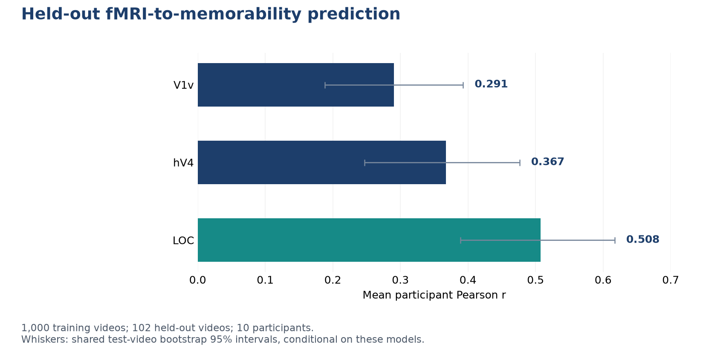

# Memorability Prediction and Representational Similarity

**Project by Giacomo Albergo** | Independent portfolio project | October 2026

An analysis of whether patterns of visual-cortex activity predict how memorable a video is, paired with representational similarity analysis that separates descriptive associations from supervised prediction.

**Technology:** Python, fMRI, ridge regression, RSA, scikit-learn

## What this demonstrates

- Used BOLD Moments ROI responses for 1,000 training videos and 102 held-out test videos across ten participants.
- Fitted separate standardized ridge models for V1v, hV4 and LOC, selecting regularization on training data only.
- Reported every predefined ROI rather than selecting the best ROI after testing.
- Resampled test videos jointly across participants to retain shared-stimulus dependence in uncertainty estimates.

## Evaluation

| Visual ROI | Mean Pearson r | Test-video bootstrap 95% interval | Mean test R2 |
| --- | ---: | ---: | ---: |
| V1v | 0.291 | 0.188 to 0.393 | 0.048 |
| hV4 | 0.367 | 0.247 to 0.476 | 0.099 |
| LOC | 0.508 | 0.389 to 0.617 | 0.225 |

LOC predictions reduced mean test MSE by 22.8% relative to a training-mean predictor, with lower error in all ten participants. The original descriptive memorability RSA associations were small; supervised decoding is a distinct task and does not replace or invalidate those earlier results.

The [aggregate metrics](results/metrics.json) contain the values behind this figure. The findings describe the stated dataset, split and evaluation protocol.

## Scope and limitations

- Predictions require measured fMRI responses; this is not a video-only memorability predictor.
- Training inputs average three repetitions, while test inputs average ten, giving test responses greater precision.
- Bootstrap intervals condition on the fitted models and these participants.
- Supervised prediction correlations measure a different question from raw voxel-pattern RSA.

## Portfolio access

This repository shares the project overview, methodology, aggregate results and figures. The implementation, training/inference code, model artifacts and full development history are maintained in a separate private repository. Access for a technical review can be discussed through [my GitHub profile](https://github.com/ZioJack99).

See [data and method sources](DATA_SOURCES.md) and [rights and attribution](RIGHTS.md). This is a portfolio showcase, not an open-source software release.
